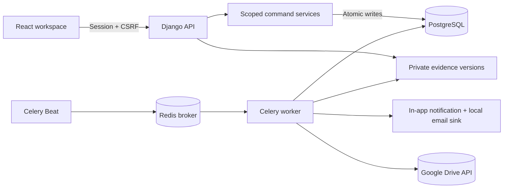

# Architecture

The browser sends an action, reason, expected version and idempotency key. Django checks current scope, serialises the actor's command identity, locks the application, verifies preconditions and commits state, decision, audit, outbox and replay response together. Actor locks protect duplicate keys; case locks protect competing commands. PostgreSQL advisory locks protect EVC interval reservations and policy activation conflicts.

## Core Architectural Lifecycles

1. **Workflow & Scoping:**
   - Case routing supports dynamic route stages (`SCRUTINY`, `EVC`, `SHC`, `SAC`, `DECISION`, `RATIFICATION`).
   - Scoping is enforced at the database query layer via `permitted_cases` and `permitted_audit_events`.
   - General grievance audit events carry explicit `scope_type='grievance'` and `institution` FK, preventing unintended exposure to non-grievance roles or other institutions.

2. **Deadlines & Responsibility:**
   - Active stage deadline ownership transfers upon case return, resubmission, or reassignment.
   - Outdated pending outbox alerts for superseded owners are automatically cancelled without mutating the underlying statutory clock.
   - EVC milestones are broken into independent tracking: `evc_scheduling`, `evc_visit`, and `evc_report`.

3. **Evidence, Safety & External Storage:**
   - Evidence versions retain immutable original receipts and checksums.
   - Files entering quarantine (e.g. PDF, DOCX) can undergo an audited manual security review (`security_review_evidence`) to transition to `security_reviewed` or `security_rejected`.
   - Google Drive integration is supported for both `website.Document` and `core.Evidence` via background Celery tasks with lease locking, retry limits, and MD5 integrity verification.

4. **Compliance & Validity:**
   - Obligations follow an 8-state lifecycle (`pending_submission`, `evidence_received`, `security_rejected`, `verification_pending`, `returned`, `fulfilled`, `renewal_required`, `expired`, `renewal_pending_verification`).
   - Renewals preserve the historical accepted validity and original evidence records.

5. **Auditing & Append-Only Guarantees:**
   - Audit events have no mutation endpoints, and a PostgreSQL trigger (`reject_audit_changes`) denies row updates and deletions.

| Source | Purpose |
| --- | --- |
| `anumati/settings.py` | Environment, database, sessions, Celery schedules |
| `core/models.py` | Relational records, constraints, and audit schema |
| `core/services.py` | Scoped transactional commands, audit access, obligation lifecycle |
| `core/views.py` | Auth, API endpoints, security reviews, reports, React assets |
| `core/tasks.py` | Deadlines, outbox recovery, background evidence validation, Drive sync |
| `core/aicte_adapter.py` | External AICTE / NSWS intake and webhook signature verification contract |
| `core/tests.py` | PostgreSQL workflow, security, concurrency, and regression test suite |
| `website/` | Independent institution grievance Django portal and models |
| `website/drive.py` | Google Drive client, upload streaming, and download proxy |
| `frontend/src/` | Main React approval workspace |
| `website/frontend/` | Institution grievance portal React frontend |
| `scripts/` | Native local lifecycle, setup, and automated smoke test scripts |

*No alternate backend or database is used. Technical admin status does not grant regulatory authority. Seeded category routes and elapsed-day clocks are explicitly synthetic fixtures, not a complete certified APH policy catalogue.*
