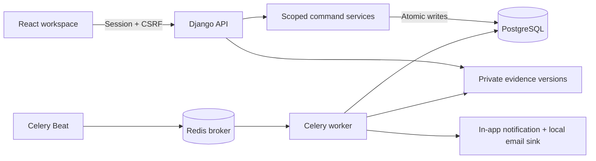

# Architecture

The browser sends an action, reason, expected version and idempotency key. Django checks current scope, serialises the actor's command identity, locks the application, verifies preconditions and commits state, decision, audit, outbox and replay response together. Actor locks protect duplicate keys; case locks protect competing commands. PostgreSQL advisory locks protect EVC interval reservations and policy activation conflicts.

Approval, obligation fulfilment, evidence safety, evidence adequacy, accepted validity and delivery are separate lifecycles. Receipts retain their original timestamp. Renewed validity changes only after an authorised finding against a particular version. Case owners and compliance verifiers can differ.

Beat only triggers scans. PostgreSQL owns deadlines and pending intent, so missed scheduler intervals and Redis queue loss are recoverable. Alert identity includes deadline revision, milestone and recipient. Workers recheck active revision, lease work, deduplicate the in-app effect and retry the local email sink. A crash can repeat an email file; exactly-once external delivery is not promised.

Audit events have no mutation endpoint and a PostgreSQL trigger rejects row updates/deletes. Database superusers can still disable triggers; independent audit retention remains a production requirement.

| Source | Purpose |
| --- | --- |
| `anumati/settings.py` | Environment, database, sessions, Celery schedules |
| `core/models.py` | Relational records and constraints |
| `core/services.py` | Scoped transactional commands |
| `core/views.py` | Auth, API, files, reports, React assets |
| `core/tasks.py` | Deadlines, outbox recovery, synthetic validation |
| `core/tests.py` | PostgreSQL workflow/security/concurrency tests |
| `frontend/src/` | React and local CSS/SVG |
| `scripts/` | Native local setup and lifecycle |

No alternate backend or database is used. Technical admin status does not grant regulatory authority. Six seeded category routes and elapsed-day clocks are explicitly synthetic fixtures, not a complete APH policy catalogue.
